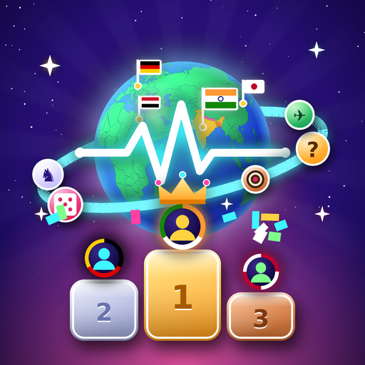
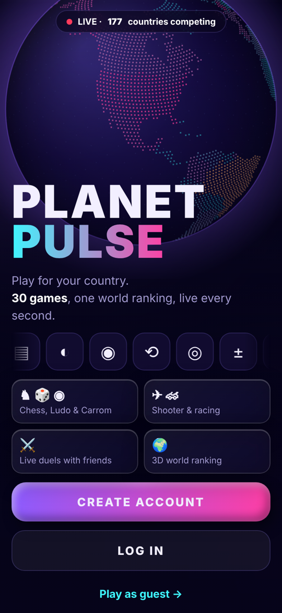
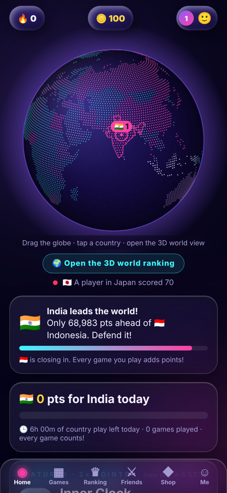
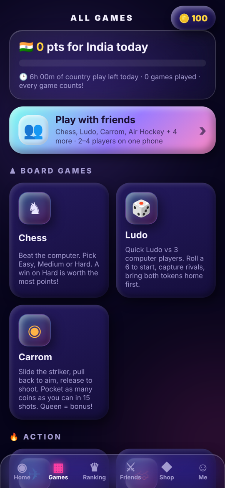
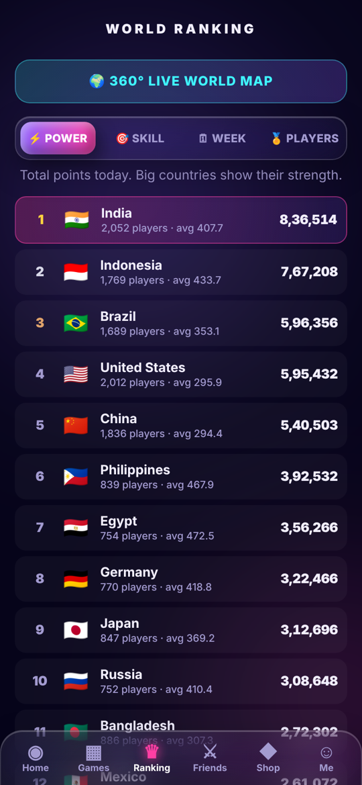

<p align="center">
  
</p>

<h1 align="center">Planet Pulse 🌍</h1>
<p align="center"><b>Play for your country.</b> 30 mini-games, one live world ranking.</p>

<p align="center">
  
  
  
  
  
</p>

---

Every game you play earns points for **your country**. Countries compete on a live 3D globe and a
world leaderboard that resets every day. Pick your team, keep your streak alive and push your country to #1.

## 📱 Screenshots

| Welcome | Home | Games | World ranking |
|:---:|:---:|:---:|:---:|
|  |  |  |  |

## ✨ Features

- 🌍 **Country vs the world:** choose your country (auto-detected) and every game adds points to its score
- 🗺️ **Interactive 3D globe** showing which countries are leading, with live score updates
- 🎮 **30 games** in one app:
  - **Board games:** Chess (Easy / Medium / Hard), Ludo, Carrom, Connect Four, Snakes & Ladders, Dots & Boxes
  - **Skill & brain games:** Reflex Rush, Memory Flash, Quick Math, Inner Clock, Hue Match, Draw a Circle and more
  - **Action games:** Meteor Dodge, Star Strike, Neon Rush, Stack Tower, plus shooter and racing
- 👥 **Play with friends:** 2–4 players on one phone, or live duels with a friend code
- 🏆 **Leaderboards:** by total power, skill, week and top players
- 🔥 **Daily streaks, coins and a featured 2× points game** every day
- 📶 **Works offline:** installable as an app (PWA) with a service worker

## 🛠️ Tech

- **Frontend:** a single `index.html` with HTML, CSS and vanilla JavaScript (no framework)
- **PWA:** `manifest.json` + `sw.js` for install-to-home-screen and offline play
- **Backend (optional):** Supabase for accounts, live duels and the real world ranking, with one server per
  region (Asia, Europe, Americas). Without a server configured, the game runs in **demo mode** with sample data.

## 🚀 Run it locally

You only need a browser and Python (to serve the files).

```
git clone https://github.com/sauravh-dev/planet-pulse.git
cd planet-pulse
python -m http.server 8000
```

Then open **http://localhost:8000** in your browser.
Tip: open your browser's mobile view (F12 → phone icon), because the game is designed for phones.

## 📁 Project structure

```
├── index.html      # the whole game: screens, 30 games, globe, ranking
├── manifest.json   # app name, icons, colours (for installing as an app)
├── sw.js           # service worker: caches files so it works offline
├── icons/          # app icons (192, 512, maskable)
└── docs/           # screenshots and Play Store icon for this README
```

## 🗺️ Roadmap

- [x] 30 games, country picker, 3D globe, leaderboards
- [x] Offline / installable PWA
- [ ] Connect live Supabase servers for real players
- [ ] Publish on the **Google Play Store**
- [ ] Ads with AdMob

## 📄 License

© 2026 Sauravh. All rights reserved.
